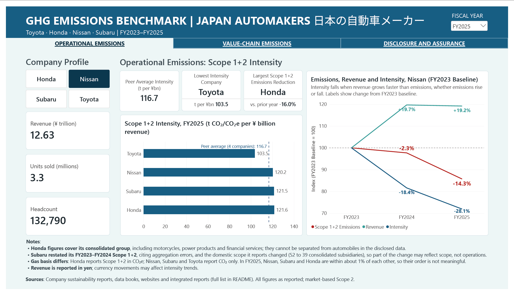
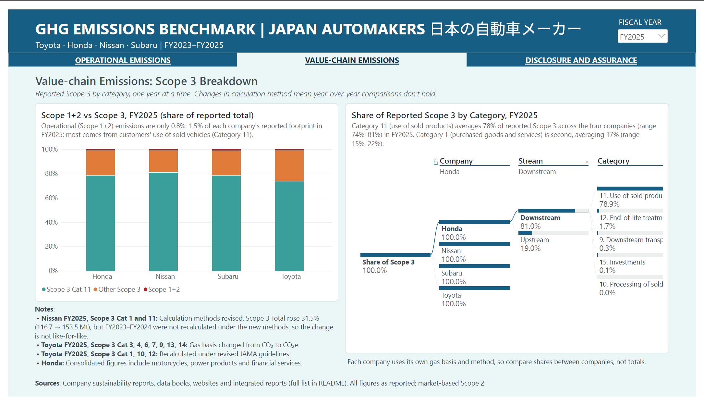
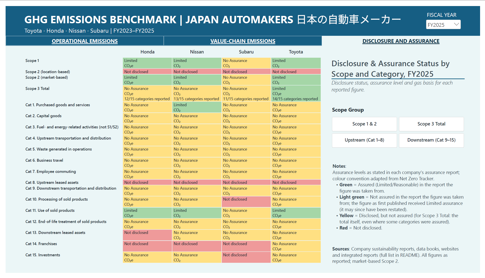
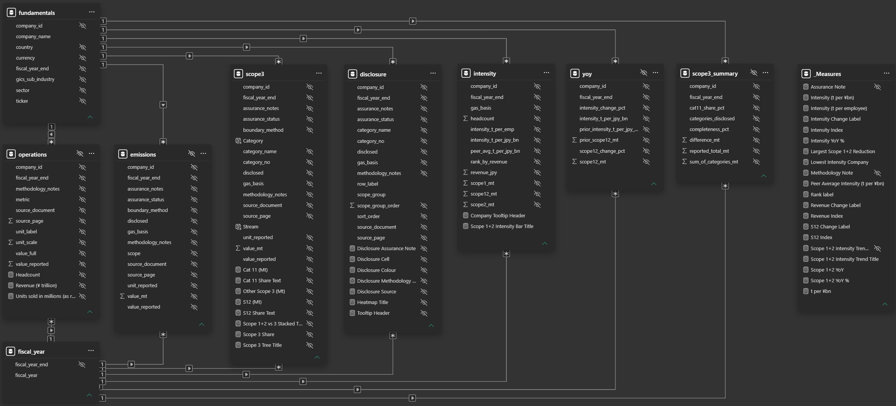

# GHG Emissions Benchmarking Dashboard - Japanese Automakers 日本の自動車メーカー

---



---

## Contents

 - [Introduction](#introduction)
 - [Key Findings](#key-findings)
 - [How to view this on GitHub](#how-to-view-this-on-github)
 - [Dashboard Overview](#dashboard-overview)
 - [Methodology](#methodology)
     - [Scope and Data Sources](#scope-and-data-sources)
     - [Limitations](#limitations)
 - [Data Model](#data-model)
 - [Use of AI](#use-of-ai)
 - [Repo Structure](#repo-structure)
 - [What's Next?](#whats-next)
 - [References](#references)
 - [Disclaimer and License](#disclaimer-and-license)

---

## Introduction

 This project was built around applying Excel, SQL, and Power BI to real ESG data, using the greenhouse gas emissions of four Japanese automakers (Honda, Nissan, Subaru, Toyota) as its subject matter. 

 Before building, Claude (Anthropic) researched existing public dashboards and benchmarks to help choose metrics with an established precedent and to identify known comparability issues: mixed CO₂/CO₂e reporting, Honda's consolidated boundary, and method changes behind year-on-year jumps. 

 Data was collected manually from each company's English-language ESG data books, sustainability reports, and integrated reports covering FY2023–FY2025. During data collection, those comparability issues were confirmed first-hand and others surfaced: All four companies structure their emissions reporting around the GHG Protocol’s scopes and Scope 3 categories, yet differ on which gases they count, what is independently assured, what gets restated, and how Scope 3 is calculated.

 These issues are framed around three questions drawn from two qualitative characteristics in IFRS S1 (Appendix D on "Qualitative characteristics of useful sustainability-related financial information"). None of the four companies reported under ISSB Standards or SSBJ Standards in the period covered, hence S1 is used here purely as a lens:
  1. **Is each company's data comparable with its own previous periods?** (Comparability, D17(a); consistency, D19)
  2. **Is it comparable with its peers?** (Comparability, D17(b))
  3. **Can it be trusted?** (Verifiability, D21–D23)
 
 Following D20, "comparability is not uniformity", figures are kept as reported rather than adjusted to look alike. The dashboard flags where they differ in basis or method.

---

## Key Findings
 
 1. Toyota's FY2024 Scope 1+2 emissions rose 3.6%, but since revenue grew faster at 21.4%, intensity then fell 14.6%. This illustrates how revenue growth outpacing emissions can make intensity appear to fall even when emissions rise, and vice versa.

 2. In FY2025, Nissan's reported Scope 3 emissions rose 31.5%, in the same year it revised its calculation methods for Category 1 (purchased goods and services) and Category 11 (use of sold products), which together make up most of its Scope 3. Because Nissan's Data Book 2025 reports only FY2025 under the new methods, year-over-year changes in its Scope 3 mix real change with method change. Nissan also stopped reporting Category 8 (upstream leased assets) and Category 14 (franchises), both previously reported as zero, without explanation.

 3. In FY2025, Category 11 (use of sold products) is the largest Scope 3 category at all four companies, averaging 78% of reported Scope 3 (range 74–81%). Category 1 (purchased goods and services) is second, averaging 17% (range 15–22%). Scope 1+2 combined is only 0.8–1.5% of each company’s reported footprint.

 4. In the reports reviewed, 3 of 4 companies reported that limited assurance engagement was performed on their Scope 1, 2 and some Scope 3 figures. The assurance engagements covered only the reporting period of each report; prior-year figures republished in the same report, whether restated or not, were not covered. 1 of 4 companies, Subaru, did not report third-party assurance engagement on any GHG figure in any report.

 5. None of the four companies states its organizational boundary approach (operational control, financial control, or equity share) for its GHG inventory in any of the three reporting cycles.

---

## How to view this on GitHub

 GitHub can't display Power BI files in the browser. Choose whichever option suits you:

 | Option | What you need | What you get |
 |---|---|---|
 | [`ghg_emissions_benchmarking.pdf`](report/ghg_emissions_benchmarking.pdf) | Nothing — opens in the browser | Static export of all three pages |
 | [`ghg_emissions_benchmarking.pbix`](report/ghg_emissions_benchmarking.pbix) | [Power BI Desktop](https://www.microsoft.com/en-us/power-platform/products/power-bi/desktop) (free, Windows) | Full interactive report: slicers, tooltips, drill-down. Data is embedded, so it opens without a database. |
 | [Screenshots](screenshots/) | Nothing | Images of each page, also shown below |

 To download the `.pbix`, open the file link and click **Download raw file**.

 Pages marked as hidden in Power BI Desktop are tooltip pages that appear when hovering over the intensity bar chart and the disclosure grid; they are not meant to be viewed on their own.

 **To refresh the data** (requires PostgreSQL and Power BI Desktop):

 1. Create a local PostgreSQL database named `ghg_emissions_benchmarking`. The report connects to `localhost`.
 2. Open psql (or pgAdmin's PSQL Tool) connected to that database, and move to the repository root:
    ```
    \cd 'path/to/ghg-emissions-benchmarking'
    ```
 3. Run the five SQL scripts in order. They build the tables and views from `data/csv/`:
    ```
    \i sql/01_create_tables.sql
    \i sql/02_standardize.sql
    \i sql/03_intensity_ranking.sql
    \i sql/04_yoy_change.sql
    \i sql/05_scope3_checks.sql
    ```
 4. Open `report/ghg_emissions_benchmarking.pbip` in Power BI Desktop and click **Refresh**.

 The `.pbip` folders hold the report and data model as text (including all DAX measures in TMDL), for anyone who wants to read the build without opening Power BI.

---

## Dashboard Overview
 
 This Power BI report has three pages: operational emissions, value-chain emissions, and disclosure and assurance status. Navigate between them with the tab buttons directly below the report title. In the top right corner, a fiscal year dropdown switches the report between FY2025 (most current data), FY2024 and FY2023.

### Page 1: Operational Emissions


 This page analyses operational emissions performance in terms of Scope 1+2 intensity. It shows how emissions behave differently from intensity because of revenue growth.
 - **Revenue (¥ trillion), Units sold (millions), and Headcount** give the basic operating figures for the company selected in the Company Profile buttons. Honda's units sold include motorcycles and power products.
 - **Peer Average Intensity (t per ¥bn), Lowest Intensity Company (t per ¥bn), and Largest Scope 1+2 Emissions Reduction (vs. prior year)** summarize peer group performance for the selected fiscal year. The last card is ranked on absolute tonnes, not intensity, so revenue growth can't produce a "reduction".
 - **Scope 1+2 Intensity, for the selected fiscal year (t CO2/CO2e per ¥ billion revenue)** compares the four companies against the peer average. Hovering over a bar shows its intensity rank (1 = lowest) and per-employee intensity. Notes beneath the chart flag the comparability caveats: Honda's consolidated boundary, Subaru’s FY2023–FY2024 restatement and scope change, CO2 vs CO2e reporting (in FY2025, Nissan, Subaru and Honda are within about 1% of each other, so their order is not meaningful), and yen-denominated revenue.
 - **Emissions, Revenue and Intensity, for the selected company (FY2023 Baseline)** plots emissions, revenue and intensity for the selected company, indexed to FY2023 = 100; labels show the % change from FY2023. This visual ignores the fiscal year dropdown but follows the Company Profile buttons.

### Page 2: Value-chain Emissions



 This page breaks down value-chain emissions by upstream and downstream categories. Since gas basis is not uniform, Scope 3 totals cannot be compared between companies. Instead, this page compares each company's shares of its own reported emissions.
 - **Scope 1+2 vs Scope 3, for the selected fiscal year (share of reported total)** shows Scope 1+2, Scope 3 Category 11, and other Scope 3 categories as a % share of each company's reported total.
 - **Share of Reported Scope 3 by Category, for the selected fiscal year** drills each company's Scope 3 shares down by company → upstream/downstream → category. Hovering shows the value in million tonnes.
 - **Notes** list the method changes that affect comparison over time (Nissan’s FY2025 method revision, Toyota's switch from CO2 to CO2e for seven categories, Toyota's JAMA recalculation) and Honda's consolidated boundary.

### Page 3: Disclosure And Assurance



 This page maps the disclosure and assurance status of Scope 1, 2 and 3 emissions. Knowing where data is disclosed, under what level of assurance (limited or reasonable) it is covered, and which gas basis (CO2 or CO2e) it uses determines how much confidence each analysis in this report deserves.
 - **Disclosure & Assurance Status** shows, for each company's Scope 1, Scope 2, Scope 3 Total and each Scope 3 category, the assurance level and gas basis; Scope 3 Total cells also show how many of the 15 categories were reported. Select from the Scope Group slicer to filter for a specific grouping, and hover over a cell to see its source, assurance and methodology notes. The colour classification, adapted from Net Zero Tracker, is as follows:
     - Green = Assured (Limited or Reasonable, as stated in the company’s assurance report) in the report the figure was taken from.
     - Light green = Not assured in the report the figure was taken from; the figure as first published received Limited assurance (it may since have been restated).
     - Yellow = Disclosed, but not assured (for Scope 3 Total: the total itself, even where some categories were assured).
     - Red = Not disclosed.
 
---

## Methodology

### Guidelines

 - **Transcription.** Every value is transcribed exactly as published, in the published unit, into one Excel workbook per company. No calculation happens in the workbooks. Each value cites its `source_document` and `source_page`, the page number shown in a PDF viewer. In some reports this is not the same as the number printed on the page.
 
 - **Fiscal years.** All four companies' fiscal years end on March 31. This project labels each fiscal year by the calendar year it ends: FY2025 = April 1, 2024 – March 31, 2025; FY2024 = April 1, 2023 – March 31, 2024; FY2023 = April 1, 2022 – March 31, 2023. The companies label the same years differently (Nissan, for example, calls the year ending March 2025 "fiscal year 2024"), so the workbooks store each year as its exact end date (`fiscal_year_end`, e.g. 2025-03-31), and the dashboard shows the FY labels above.

 - **Unit standardisation.** The workbooks are exported to CSV (`scripts/export_csv.py`) and loaded into PostgreSQL. A `units` table maps every reported unit (t, kt, million t; CO₂ or CO₂e) to million tonnes, and the view in `02_standardize.sql` applies it. Power BI reads the standardised views.

 - **Gas basis.** Each row's gas basis (CO₂ or CO₂e) is derived from its published unit and kept as a column. CO₂ and CO₂e figures are treated as equivalent for calculation but are never presented as the same: the basis is shown on the Disclosure & Assurance grid and flagged in chart notes.

 - **Assurance.** Recorded as the level stated in each company’s independent assurance report (Limited, Reasonable) or No Assurance. Assurance belongs to the report a figure is taken from: a prior-year figure republished in a later report, whether restated or not, is “No Assurance” in that report, with its original assurance recorded in the notes (shown light green on the grid).

 - **Restatements.** Where the latest report discloses prior years, its figures are used for all three years, and each row records whether the figure was restated against the report that first published it. Where it does not (for example Nissan’s Scope 3 and some units-sold figures), the original report’s figure is used and marked “Not republished”.

 - **Restated** means a prior-year figure was republished in a later report with a different value; **Not restated** means it was republished unchanged; **Not republished** means the later report omits it and the original report's figure is used.

 - **Method changes.** Where a company changes its calculation method, affected figures are marked as not comparable with prior years and annotated on the dashboard (Nissan FY2025 Scope 3; Toyota FY2025 gas basis; Toyota JAMA recalculation).

 - **Missing values.** "N/A", "-" or blank in the source is recorded as not disclosed. A reported 0 is a disclosed zero. Nothing is estimated or gap-filled.

 - **Scope 2.** Market-based figures are used for all metrics. No company discloses a location-based figure for the period; those rows are recorded as not disclosed.

 - **Checks.** Scope 3 categories are summed and reconciled against each company's reported Scope 3 total; all twelve company-years reconcile within rounding. Together with page-level source citations, this is how the dataset supports verifiability (IFRS S1, D23(a)–(b)).

### Metrics

| Metric | Definition | Built in |
|---|---|---|
| Scope 1+2 intensity | (Scope 1 + Scope 2 market-based) ÷ consolidated revenue, t per ¥ billion | SQL / DAX |
| Peer average intensity | Simple average of the four companies, each weighted equally | DAX |
| Intensity rank | Rank of the four companies per year (1 = lowest intensity) | SQL (`RANK()`) |
| Year-over-year change | Change in absolute Scope 1+2 and in intensity vs. prior year | SQL (`LAG()`) |
| Largest Scope 1+2 reduction | Largest year-over-year fall in absolute tonnes, not intensity | DAX |
| Indexed trend | Emissions, revenue and intensity ÷ FY2023 value × 100 | DAX |
| Intensity per employee | (Scope 1 + Scope 2 market-based) ÷ consolidated headcount (tooltip only) | DAX |
| Scope 3 share | Category or stream ÷ the sum of the company's reported Scope 3 categories | DAX |
| Scope 1+2 share of footprint | Scope 1+2 ÷ (Scope 1+2 + sum of reported Scope 3 categories) | DAX |
| Categories reported | Count of the 15 Scope 3 categories with a reported value, including a reported 0 | SQL |

 **Counting rule.** A Scope 3 category counts as reported when the company gives a value for it, including 0. "N/A", "-", blank, or a category reported under another scope does not count. This is a count, not a completeness score: some categories may not apply to a company's business, so fewer than 15 is not by itself a gap.

 **Denominators.** Revenue is consolidated and in yen; no currency conversion is applied. Headcount is consolidated, and definitions such as part-time inclusion vary by company. Units sold are shown as context only and are never used as a denominator.

### Scope and Data Sources

 **Companies:** Four Japanese automobile manufacturers. All publish English-language GHG data.

 **Period:** FY2023–FY2025 (fiscal years ending March 31, 2023, March 31, 2024, and March 31, 2025). FY2026 reports are available for Toyota, Honda and Nissan but not yet for Subaru, so all four are held at FY2025 to keep the comparison on the same reporting cycle.

 **Boundary:** Each company's consolidated reporting scope, as stated in its own reports.

 | Company | Ticker | ESG reports | Financial reports |
 |---|---|---|---|
 | Toyota | 7203.T | [Sustainability Data Book 2023–2025](https://global.toyota/en/sustainability/report/archives/) | [Integrated Report 2023–2025](https://global.toyota/en/ir/library/annual/) |
 | Honda | 7267.T | [ESG Report 2025; ESG Data Book 2023–2024](https://global.honda/en/sustainability/report.html) | [Honda Report 2023–2025](https://global.honda/en/integratedreport/#backnumber-report) |
 | Nissan | 7201.T | [Sustainability Data Book 2023–2025](https://www.nissan-global.com/EN/SUSTAINABILITY/LIBRARY/) | [Financial Results Summaries FY2023–FY2024 (fiscal years ending March 31, 2024 and March 31, 2025)](https://www.nissan-global.com/EN/IR/FINANCIAL_RESULTS/) |
 | Subaru | 7270.T | [Sustainability Website 2023–2025](https://www.subaru.co.jp/en/csr/report/) | [Integrated Report 2023–2025](https://www.subaru.co.jp/en/ir/library/annual-reports.html) |

 Earlier editions of each report were used to check restatements and original assurance. Every value in the workbooks cites its source document and page; the full source list for each company is in the README sheet of its workbook (`data/*_raw.xlsx`).

### Limitations
 
 - **Four companies, three years.** Enough to demonstrate the method, not to draw conclusions about the sector.
 
 - **CO₂ vs CO₂e.** Gas basis differs by company and scope. For Scope 1+2, Honda reports CO₂e while Nissan, Subaru and Toyota report CO₂ only. For Scope 3, Honda and Toyota report CO₂e (Toyota for all categories only from FY2025), while Nissan and Subaru report CO₂ only. The two are treated as equivalent for calculation and flagged on the dashboard. Where intensities are close, as with Nissan, Subaru and Honda in FY2025, the difference in gas basis can exceed the gap, so they cannot be ranked against each other.
 
 - **Boundary changes and differences.** Honda's consolidated boundary includes motorcycles, power products and financial services, which cannot be separated from automobiles in the disclosed data; the same applies to its units sold. Subaru restated its FY2023–FY2024 Scope 1+2, citing errors in aggregated data, and the domestic scope it reports changed from 52 to 39 consolidated subsidiaries, so part of its year-on-year change may reflect scope, not operations.

 - **Organisational boundary not stated.** None of the four companies states whether it uses operational control, financial control or equity share.
 
 - **Different stated frameworks.** The four companies do not describe their methodology the same way. Toyota states its market-based Scope 2 is "in accordance with the GHG Protocol" (Toyota Sustainability Data Book 2025, p.60); Honda states it adopts the GHG Protocol’s market-based method for Scope 2 (Honda ESG Report 2025, p.61); Nissan calculates "based on Nissan internal standards referencing the GHG Protocol" (Nissan Sustainability Data Book 2025, p.62); Subaru cites the Ministry of the Environment and METI *Basic Guidelines on Accounting for Greenhouse Gas Emissions throughout the Supply Chain* (Ver. 2.3, 2017) (Subaru Sustainability Website 2025, p.54). All four report against the same scopes and 15 Scope 3 categories, but this project does not assess how closely each follows any one framework.

 - **Method changes break year-on-year comparison.** Nissan revised its Category 1 and Category 11 methods for FY2025 and reports only FY2025 under them; Toyota moved seven Scope 3 categories to a CO₂e basis from FY2025, while restating some earlier figures and leaving others on a CO₂ basis. Year-over-year changes in their Scope 3 totals, Category 1 and Category 11 therefore mix real change with method change, so Scope 3 is shown one year at a time and not trended.

 - **Category 11 rests on company assumptions** (vehicle lifetime mileage, regional fleet mix), so comparisons of it between companies are directional only. Carbon Tracker's *Oil Companies in Disguise* (June 2026) models Subaru's Category 11 as potentially understated by more than 200%; that estimate is modelled and is not used here.
 
 - **Revenue is in yen.** Currency movements may move intensity independently of emissions; exchange-rate effects are not isolated in this dataset.
 
 - **Scope 2 basis.** Toyota, Honda and Subaru state their Scope 2 is market-based. Nissan does not use the term, but its emission factors are supplier- and contract-specific (Nissan Sustainability Data Book 2025, p.62), which this project treats as market-based. None of the four discloses a location-based Scope 2 figure for the period, although Subaru describes a location-based calculation method.

 - **Headcount definitions vary** (for example, part-time inclusion), so per-employee intensity is shown in tooltips only.
 
 - **Assurance classification is a rule set by this project.** A prior-year figure repeated in a later report is classed as unassured in that report, even if it was assured when first published; the original assurance is recorded separately.
 
 - **Single transcriber.** All values were transcribed and checked against the source reports by the project author; transcription errors are possible.

---

## Data Model



---

## Use of AI

 This project used Claude (Anthropic) as a research assistant, coding tutor and reviewer. The disclosure below follows the stage-by-stage approach of the AI Disclosure (AID) Framework (Weaver, 2024): only stages where AI was used are listed, with what was checked and how. Everything Claude drafted was implemented, checked against the source reports or the CSVs, and edited by the project author before it went into the project.

 | Stage | Project author | Claude | How it was checked |
 |---|---|---|---|
 | Question and framing | Chose the sector, companies and period; framed the analysis around IFRS S1 comparability and verifiability | Researched public dashboards and benchmarks for metric precedents and known comparability issues | Precedents checked at their original sources |
 | Metrics | Chose the final KPIs, denominators and the Scope 3 counting rule | Proposed candidate metrics from published precedents | Each checked against what all four companies actually disclose |
 | Data collection | Transcribed every value by hand from company reports (4 companies × 3 years, Scope 1–3 and 15 categories), with page references, restatement and original-assurance checks | Reviewed the workbooks for errors; corrected inverted restatement labels with a script, at the author’s request | Every value cites its source document and page |
 | Data methodology | Applied the workbook rules: verbatim transcription, restatements, assurance levels as stated in each report | Advised on the rules; drafted the workbook README sheets | README content checked against the source reports |
 | Python (`export_csv.py`) | Ran it and validated the output | Wrote the script | Row counts checked against the workbooks |
 | SQL (`/sql`) | Ran every script against PostgreSQL, made minor edits, and adapted the drafted patterns where the same logic repeated (for example, the gas-basis CASE in both standardised views); debugged errors with Claude's guidance | Drafted all queries: table definitions and loading, unit standardisation, intensity ranking (`RANK()`), year-over-year change (`LAG()`) and Scope 3 checks | Scope 3 reconciliation: all twelve company-years within 0.02 Mt; outputs checked against the CSVs |
 | Power Query and data model | Built the model and the combined disclosure table | Guided the steps | — |
 | DAX | Implemented and debugged every measure in Power BI; adapted title, tooltip-header and label measures; wrote early versions of the ranking measures, corrected with Claude's guidance | Drafted most measures, including disclosure cell text and colour, ranking, Scope 3 share, indexed trend and dynamic subtitles | Values reconciled to the CSVs (e.g. FY2025 Toyota intensity 103.46; Category 11 share 73.9%) |
 | Dashboard design | Page structure, layout, colour, interactions, and which caveats appear where | Theme file, an initial font and spacing pass, wording edits | Reviewed in Power BI |
 | Findings and caveats | Identified and wrote the key findings; checked each against the data | Flagged comparability issues and overstated claims for review; ran data checks on request | Each finding traced to a visual and to the CSVs |
 | README | Wrote the introduction, key findings and dashboard overview | Drafted the methodology, metrics, limitations, data sources, viewing and licence sections; redrafted parts of the introduction and key findings; reviewed all sections | Edited by the project author |

 **Where the author is still building skill:** SQL, DAX and Python are the newest parts of the author's toolkit; on this project Claude's tutoring was how they were learned.

---

## Repo Structure

```text
ghg-emissions-benchmarking/
├── data/
│   ├── honda_raw.xlsx            ← company workbooks, transcribed from source reports
│   ├── nissan_raw.xlsx
│   ├── subaru_raw.xlsx
│   ├── toyota_raw.xlsx
│   └── csv/                      ← load-ready tables for PostgreSQL
│       ├── emissions.csv
│       ├── fundamentals.csv
│       ├── operations.csv
│       ├── scope3.csv
│       └── units.csv
├── scripts/
│   └── export_csv.py             ← workbooks → CSV export with validation
├── sql/
│   ├── 01_create_tables.sql      ← tables and CSV load
│   ├── 02_standardize.sql        ← unit conversion and gas basis
│   ├── 03_intensity_ranking.sql  ← Scope 1+2 intensity, RANK()
│   ├── 04_yoy_change.sql         ← year-over-year change, LAG()
│   └── 05_scope3_checks.sql      ← Scope 3 reconciliation and category counts
├── report/
│   ├── ghg_emissions_benchmarking.pbix                ← open this: report with embedded data
│   ├── ghg_emissions_benchmarking.pdf                 ← static export of all three pages
│   ├── ghg_emissions_benchmarking.pbip                ← Power BI project (source format)
│   ├── ghg_emissions_benchmarking.Report/             ← report definition (pages, visuals)
│   ├── ghg_emissions_benchmarking.SemanticModel/      ← data model and DAX measures (TMDL)
│   └── aijiro_theme.json                              ← custom report theme
├── screenshots/
│   ├── 1_Operational-Emissions.png
│   ├── 2_Value-chain-Emissions.png
│   ├── 3_Disclosure-and-Assurance.png
│   └── Data-Model.png
├── LICENSE
└── README.md
```

Source PDFs are kept locally and are not included in the repository.

---

## What's Next?

 1. **Wider coverage.** Add the other Japanese automakers that publish English-language GHG data (Mazda, Mitsubishi, Suzuki, Isuzu), matching the peer set in Greenpeace's *Drive to Net Zero* brief.
 2. **Longer period.** Extend to FY2023–FY2026 once Subaru publishes its FY2026 data, keeping all companies on the same reporting cycle.
 3. **Targets.** Add each company's emissions-reduction targets and progress against them; they were left out of this version to keep the scope to reported performance.
 4. **Denominator toggle.** Make the intensity ranking switchable between per ¥ of revenue and per employee, since the ranking changes with the denominator.
 5. **SSBJ disclosures.** SSBJ Standards are Japan’s sustainability disclosure standards, developed to align with the ISSB’s IFRS S1 and S2, and are being phased in as mandatory for listed companies. Once the four companies publish under them, this project can test whether they improve the comparability and verifiability issues documented here.
 6. **Restatement and method-change flags.** Restatements and method changes are currently recorded only as free-text notes in the workbooks. A future version will add a structured field for each value (Restated / Not restated / Not republished, plus a method-change flag) that carries through the CSVs, SQL views and data model. Year-over-year visuals could then mark or exclude comparisons that aren't like-for-like, such as Nissan's FY2025 Scope 3, instead of relying on page notes.

---

## References

 - **GHG Protocol.** *A Corporate Accounting and Reporting Standard*, revised edition, and *Corporate Value Chain (Scope 3) Standard*. World Resources Institute & WBCSD. https://ghgprotocol.org/corporate-standard
 - **Greenpeace East Asia** (2025, March). *The Drive to Net Zero: Japanese Automakers' Current Emissions and Opportunities* (M. Shiohata). https://www.greenpeace.org/static/planet4-eastasia-stateless/2025/03/799032d8-drive_to_net_zero.pdf
 - **Carbon Tracker Initiative** (2026, June). *Oil Companies in Disguise*. https://carbontracker.org/reports/oil-companies-in-disguise/
 - **IFRS Foundation / ISSB** (2023). *IFRS S1 General Requirements for Disclosure of Sustainability-related Financial Information*, Appendix D. https://www.ifrs.org/issued-standards/ifrs-sustainability-standards-navigator/ifrs-s1-general-requirements/
 - **Net Zero Tracker.** https://zerotracker.net/methodology
 - **SSBJ (Sustainability Standards Board of Japan).** https://www.ssb-j.jp/en/
 - **Weaver, K. D.** (2024). The Artificial Intelligence Disclosure (AID) Framework: An introduction. *College & Research Libraries News*, 85(10), 407–411. https://subjectguides.uwaterloo.ca/AIDFramework
 - **Company sources:** see Scope and Data Sources, and the README sheet in each workbook.

---

## Disclaimer and License
 
 This independent portfolio project is not affiliated with, endorsed by, or reviewed by Toyota Motor Corporation, Honda Motor Co., Ltd., Nissan Motor Co., Ltd., or Subaru Corporation.

 All emissions, assurance and operational figures are transcribed as reported in each company's public sustainability and integrated reports, with source document and page cited for every value. No figures are estimated or adjusted. Transcription errors are possible; the source reports remain the authoritative record. Nothing here is an ESG rating, an investment recommendation, or an assessment of any company's climate performance beyond what the disclosed data shows.

 The code in this repository (SQL, Python and Power BI project files) is released under the MIT License — see `LICENSE`. The underlying disclosure data remains the property of the respective companies and is used here for non-commercial analysis and commentary.
